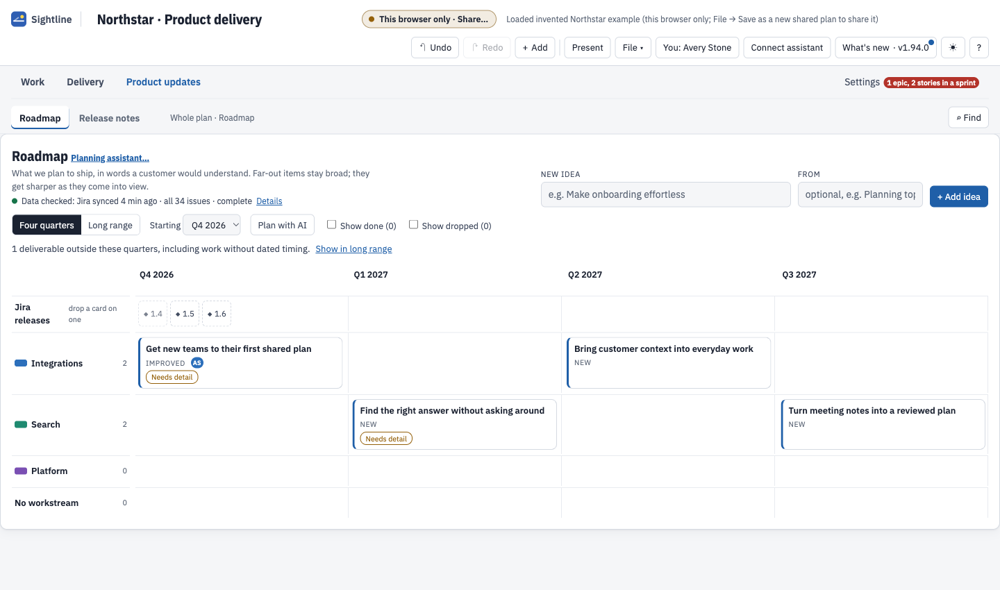
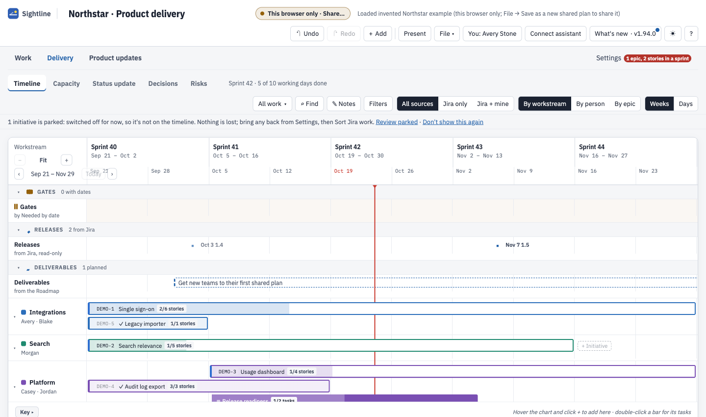
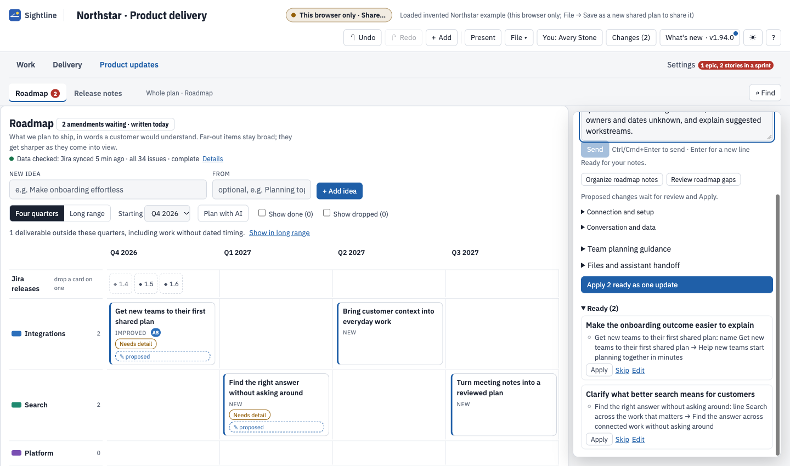
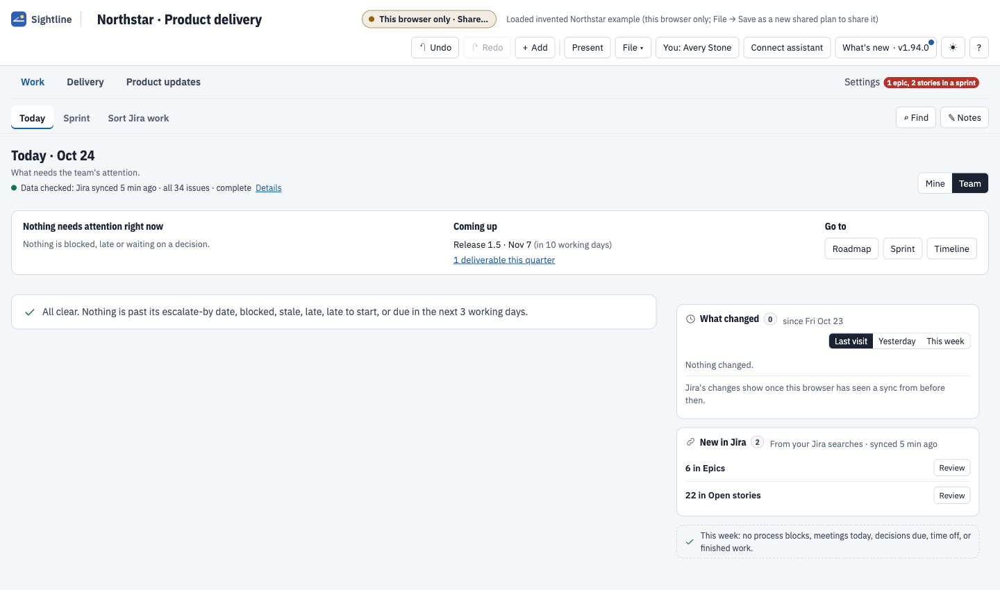

# Sightline

Sightline is a shared planning workspace for teams managing a large, changing roadmap. It connects the
outcomes you want to deliver with the work, dependencies, people, and decisions behind them. Use your own
AI assistant to sort through rough input and propose changes, then review those changes in the plan.

## When the roadmap is bigger than the conversation

You have work in Jira, requests in meeting notes, commitments made in different conversations, and several
teams contributing to the same outcomes. Everyone knows part of the plan. Getting a reliable picture means
asking around, rebuilding a spreadsheet, or scheduling another meeting.

The difficult questions are usually:

- **What are we actually committing to?** Separate agreed work from ideas, duplicates, and unresolved requests.
- **How does it all fit together?** See which initiatives support an outcome and what depends on something else.
- **Can the people we have do this?** Examine known load and availability, and expose the estimates or assumptions still missing.
- **What should change when priorities change?** Discuss scope and sequencing with the relevant work in view.
- **How do we keep everyone aligned?** Use the same plan for roadmap reviews, delivery conversations, daily attention, and updates.

Sightline gives those conversations a shared place to happen. Jira can continue to own issue facts. The plan
holds the surrounding work, outcome targets, dependencies, annotations, risks, and decisions. You can also
start without Jira.

[Walk through a large-roadmap planning session](docs/roadmap-planning-example.md) ·
[Open the example yourself](docs/getting-started.md) · [Connect your AI tool](docs/assistant-workflow.md)

## 1. Get the whole roadmap into view

Start with the outcomes the team is trying to deliver across the coming quarters. Group them by workstream,
keep future ideas visible, and distinguish planning intent from finished work. You do not need to turn every
rough idea into a dated commitment before you can discuss it.

<picture><source media="(prefers-color-scheme: dark)" srcset="docs/images/roadmap-dark.png"></picture>

*Actual Roadmap view, using a small invented Northstar plan so the labels remain readable. The notice above
the quarters keeps later work recoverable. A target quarter expresses intent; it does not prove capacity.*

## 2. Connect the roadmap to the work behind it

Move from the quarter-level discussion to the delivery timeline. Arrange initiatives, tasks, milestones, and
dependencies. Work **From Jira** keeps its issue facts; work **Added here** covers the planning around it.
The views describe the same plan, so the delivery discussion stays connected to the roadmap.

<picture><source media="(prefers-color-scheme: dark)" srcset="docs/images/timeline-dark.png"></picture>

*Actual Timeline view of the invented plan. Jira titles, status, assignees, points, and sprint dates remain
read-only. Moving or annotating work here does not update Jira.*

For a large plan, use saved views and filters to focus a discussion. Read the scope and hidden-work counts
before drawing conclusions: Roadmap uses the whole plan; Timeline and Capacity retain their own views and filters.
[Workspace guide](docs/workspaces.md).

## 3. Use AI to work through the complexity

Give your external AI coding tool the current planning context and the rough material you want to work through:
notes, requests, constraints, or a brain dump. Keep the original input. Ask it to reconcile the material against
existing work, explain its reasoning, and bring back the decisions that need you.

For example:

> We have more requests than we can commit to next quarter. Read the current plan and these notes. Account
> for every request: match it to existing work, flag a possible duplicate, retain it as an idea, or identify
> a decision. Suggest an arrangement around outcomes. Keep agreed commitments separate from suggestions.
> Show what we need to know about capacity before deciding what fits. Do not change the plan yet.

The useful result is a clearer set of choices: which requests describe the same need, which work has no
clear outcome, which decisions block progress, and which capacity questions the available evidence can answer.
You can then ask for a smaller scope, different sequencing, or proposals for the changes you choose.

### Capacity needs evidence

Sightline has a Capacity workspace. An assistant can help interpret supplied load and availability, missing
estimates, competing work, and dependencies. An outcome count, target quarter, or task duration alone cannot
establish that a team has enough capacity.

**Automatic export of capacity, dependencies, risks, and decisions requires Sightline 1.96.0 or later.** The
current public source is 1.94.0 and has narrower roadmap context; provide additional evidence deliberately
if you need that analysis. Even the richer export covers known scheduled Jira points and configured
availability, not every form of demand. [Available builds](docs/availability.md) ·
[How to reason about capacity](docs/large-roadmaps.md#3-ask-what-actually-constrains-delivery).

See a [worked planning session](docs/roadmap-planning-example.md) with messy requests, shared dependencies,
unknown capacity, and a concrete decision brief. It is an illustrative exercise, separate from the screenshot data.

## 4. Review changes before they become the plan

The assistant writes proposals. Sightline checks them against the current plan and shows the before/after
values. Apply, edit, or skip each change. Keep unrelated decisions independently reviewable, and use Undo for
a just-applied plan edit. An AI conversation or proposal file does not silently change the shared plan.

<picture><source media="(prefers-color-scheme: dark)" srcset="docs/images/review-dark.png"></picture>

*Actual review of two prepared wording changes in Northstar. These are example proposals, not a claimed live
AI response. The nearby chat controls are optional; with an external coding tool, the conversation stays in that tool.*

The [first-session walkthrough](docs/getting-started.md) includes a separate prepared exercise: move one outcome
to an earlier quarter and capture another as an unassigned, unscheduled idea. No AI account is needed to try review.

## 5. Keep the plan useful between roadmap meetings

Use **Work → Today** to find attention items, blockers, and upcoming work. Use **Sprint** for the current sprint,
**Status update** for the delivery conversation, and **Release notes** for customer wording. Return to Roadmap
when the question is about the broader direction.

<picture><source media="(prefers-color-scheme: dark)" srcset="docs/images/today-dark.png"></picture>

*Actual Today view of the invented plan. Check scope and data freshness before treating the view as a complete picture.*

An assistant can prepare the next review from supplied evidence, turn meeting notes into proposed plan updates,
and draft an explanation of what changed. People still decide priorities, resolve tradeoffs, and review changes.
[Team planning and handoffs](docs/team-planning.md) · [Six reusable assistant skills](docs/skills.md).

## How it works

The app is **one HTML file** you open in desktop Chrome or Edge. Your plan is a separate JSON or YAML file.
There is no planning server or account to set up. Share the plan through your team's file service; each person
opens it in Sightline. The optional Jira Data Center helper reads Jira and writes local files for the page.

For AI, connect a **private assistant folder** from Sightline and give its location and the copied instructions
to your file-capable coding tool. Sightline writes context; the assistant writes proposals; you review them here.
Your tool supplies the model connection. In-app chat is an optional advanced route.
[External assistant setup](docs/assistant-workflow.md) · [Jira setup](docs/jira.md).

Shared-file editing needs coordinated handoffs. Locks are advisory, author names are not verified identities,
and a successful local save does not prove cloud delivery. Use file-service permissions for access and read
[shared-file setup and recovery](docs/onedrive.md) before a team rollout. The app can request Google Fonts;
it falls back to system fonts when unavailable.

## Try it with an invented team plan

The available public route is a source build. You need Git, Node.js 18+, Python 3.10+, and Bash:

```sh
git clone https://github.com/troylar/sightline-planner.git sightline
cd sightline
npm ci
./build.sh
```

Open **dist/sightline.html** in desktop Chrome or Edge. Choose **File → Open shared plan…** and select
**examples/northstar/plan.json** from the checkout. [Follow the walkthrough](docs/getting-started.md) to explore
the plan, review prepared changes, and save a plan of your own.

Or give your coding assistant the repository link and ask:

> Clone Sightline into a new folder, read its project instructions, install its development dependencies,
> and build the HTML. Tell me where to open it and the Northstar example. Preserve any existing checkout.

There is currently no public npm package or GitHub release download. The newer capacity export and embedded
skill installer are described with their version requirements; they are not part of the public 1.94.0 source.
[Version and download availability](docs/availability.md).

## Documentation

| What you need | Start here |
| --- | --- |
| Understand a large-roadmap planning session | [Worked example](docs/roadmap-planning-example.md) |
| Work through your own roadmap and capacity questions | [Large-roadmap guide](docs/large-roadmaps.md) |
| Open the app and try a prepared example | [First session](docs/getting-started.md) |
| Use your external AI tool | [Assistant workflow](docs/assistant-workflow.md) |
| Prepare meetings, capture decisions, and hand off work | [Team planning](docs/team-planning.md) |
| Understand views, scope, and filters | [Workspaces](docs/workspaces.md) |
| Choose reusable instructions for your assistant | [Planning skills](docs/skills.md) |
| Build, validate, or contribute | [Contributing](CONTRIBUTING.md) |
| See application changes | [Release history](CHANGELOG.md) |

Sightline is [MIT licensed](LICENSE). [Third-party notices](THIRD-PARTY-NOTICES.md).
