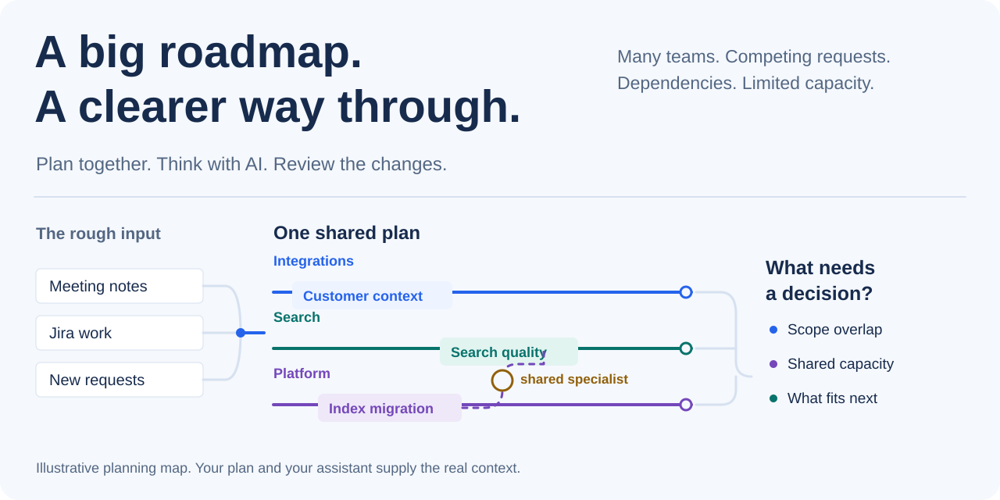
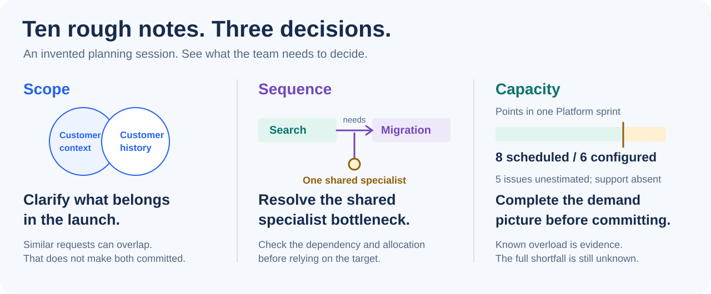

# Sightline

<picture>
  <source media="(max-width: 640px) and (prefers-color-scheme: dark)" srcset="docs/images/roadmap-map-mobile-dark.svg">
  <source media="(max-width: 640px)" srcset="docs/images/roadmap-map-mobile-light.svg">
  <source media="(prefers-color-scheme: dark)" srcset="docs/images/roadmap-map-dark.svg">
  
</picture>

**Sightline is a shared planning workspace for teams managing a large, changing roadmap—with their own AI assistant.**

You have requests in meeting notes, work in Jira, and several teams depending on one another. Everyone knows
part of the plan. Sightline connects the outcomes, delivery work, people, and decisions so you can work through
the whole picture together. Your assistant helps organize the complexity; you decide what changes.

<p align="center">
  <a href="docs/roadmap-planning-example.md"><b>See a planning session</b></a> &nbsp; / &nbsp;
  <a href="docs/getting-started.md"><b>Try the example</b></a> &nbsp; / &nbsp;
  <a href="docs/assistant-workflow.md"><b>Bring your AI</b></a>
</p>

## 1. Get the whole roadmap into view

What are we trying to deliver? What is agreed, and what is still an idea? Start with outcomes across quarters
and workstreams. Keep later work recoverable without turning every rough request into a dated commitment.

<a href="docs/images/roadmap-light.png?raw=true" aria-label="Open full-size roadmap screenshot"><picture><source media="(prefers-color-scheme: dark)" srcset="docs/images/roadmap-dark.png"></picture></a>

*Actual app, invented Northstar plan. A target quarter expresses intent; it does not prove capacity.*

## 2. Connect the roadmap to the work behind it

Move from the quarter-level discussion to initiatives, tasks, milestones, and dependencies. Keep work
**From Jira** alongside work **Added here**. Use saved views to focus on a team or workstream while keeping
hidden work findable.

<a href="docs/images/timeline-light.png?raw=true" aria-label="Open full-size timeline screenshot"><picture><source media="(prefers-color-scheme: dark)" srcset="docs/images/timeline-dark.png"></picture></a>

*Jira owns issue facts. Sightline owns the plan around them. Arranging work here does not update Jira.*

Roadmap uses the whole plan; Timeline and Capacity retain their own views and filters.
[Understand views and scope](docs/workspaces.md).

## 3. Use AI to work through the complexity

Bring the messy version: requests, constraints, meeting notes, or a brain dump. Your external AI coding tool
reads the supplied planning context, reconciles the input against existing work, and helps you think through choices.

> Account for every request. Match it to existing work, flag a possible duplicate, retain it as an idea, or
> identify a decision. Suggest an arrangement around outcomes. Keep commitments separate from suggestions.
> Show what we need to know about capacity before deciding what fits. Do not change the plan yet.

<picture>
  <source media="(max-width: 640px) and (prefers-color-scheme: dark)" srcset="docs/images/planning-decisions-mobile-dark.svg">
  <source media="(max-width: 640px)" srcset="docs/images/planning-decisions-mobile-light.svg">
  <source media="(prefers-color-scheme: dark)" srcset="docs/images/planning-decisions-dark.svg">
  
</picture>

*An invented exercise, not a screenshot or captured AI response. [Follow all ten source notes through the planning session](docs/roadmap-planning-example.md).*

Compare scope, sequencing, and workload options in the conversation. Then ask for proposals for the changes
you choose. Sightline does not provide an automatic scenario simulator.

**Capacity needs evidence.** Known load, availability, missing estimates, and dependencies matter. An outcome
count alone cannot tell you what fits. Automatic export of capacity, dependencies, risks, and decisions requires
**1.96.0+**; public **1.94.0** has narrower roadmap context, so supply additional evidence deliberately. Even the
richer export covers known scheduled Jira points and configured availability, not every form of demand.
[Capacity reasoning](docs/large-roadmaps.md#3-ask-what-actually-constrains-delivery) · [Build availability](docs/availability.md).

## 4. Review changes before they become the plan

See before/after values. Apply, edit, or skip each proposal. Use Undo for a just-applied plan edit. Your
assistant's conversation and proposal file do not silently change the shared plan.

<a href="docs/images/review-light.png?raw=true" aria-label="Open full-size review screenshot"><picture><source media="(prefers-color-scheme: dark)" srcset="docs/images/review-dark.png"></picture></a>

*Actual review of prepared Northstar wording changes. With an external coding tool, your conversation stays
in that tool; the nearby in-app chat controls are optional.*

[Try a prepared review yourself](docs/getting-started.md#review-two-changes): move one outcome to an earlier
quarter and capture another as an unscheduled idea. No AI account needed.

## 5. Keep the plan useful between meetings

Find attention items in **Today**, current work in **Sprint**, and the delivery conversation in **Status update**.
Use **Release notes** for customer wording. Return to Roadmap for the broader direction.

<a href="docs/images/today-light.png?raw=true" aria-label="Open full-size today screenshot"><picture><source media="(prefers-color-scheme: dark)" srcset="docs/images/today-dark.png"></picture></a>

*The same invented plan, viewed for daily attention. Check scope and freshness before relying on the summary.*

Have your assistant prepare a review, turn meeting notes into proposed updates, or draft an explanation of what
changed from supplied evidence. [Run a team planning session](docs/team-planning.md) · [Explore the six planning skills](docs/skills.md).

## How it works

**One HTML app. A separate plan file. Your own AI tool.**

- Open Sightline in desktop Chrome or Edge. Your plan is JSON or YAML; share it through your team's file service.
- Connect a private assistant folder. Sightline writes context; your file-capable assistant writes proposals; you review them here. Your tool supplies the model connection.
- Optionally add the read-only Jira Data Center helper. The page reads its local outputs and never contacts Jira.

There is no planning server or account to set up. Shared files need coordinated editing and handoffs: locks are
advisory, author names are not verified identities, and a local save does not prove cloud delivery. Use file-service
permissions for access. The app can request Google Fonts and falls back to system fonts.

[Assistant setup](docs/assistant-workflow.md) · [Jira setup](docs/jira.md) · [Sharing and recovery](docs/onedrive.md).

## Try it with an invented team plan

The available public route is a source build. You need Git, Node.js 18+, Python 3.10+, and Bash:

```sh
git clone https://github.com/troylar/sightline-planner.git sightline
cd sightline
npm ci
./build.sh
```

Open **dist/sightline.html** in Chrome or Edge. Choose **File → Open shared plan…** and select
**examples/northstar/plan.json**. [Follow the first-session walkthrough](docs/getting-started.md).

Or give your coding assistant the repository link and ask:

> Clone Sightline into a new folder, read its project instructions, install its development dependencies,
> and build the HTML. Tell me where to open it and the Northstar example. Preserve any existing checkout.

No public npm package or GitHub release download is available yet. Newer local builds are explicitly
version-gated in the docs. [Check version and download availability](docs/availability.md).

## Documentation

| Plan | Connect | Operate |
| --- | --- | --- |
| [Worked planning session](docs/roadmap-planning-example.md) | [Your AI assistant](docs/assistant-workflow.md) | [Team planning](docs/team-planning.md) |
| [Large roadmaps and capacity](docs/large-roadmaps.md) | [Jira Data Center](docs/jira.md) | [Views and scope](docs/workspaces.md) |
| [First session](docs/getting-started.md) | [Planning skills](docs/skills.md) | [Shared-file recovery](docs/onedrive.md) |

[Contributing](CONTRIBUTING.md) · [Release history](CHANGELOG.md) · [MIT license](LICENSE) · [Third-party notices](THIRD-PARTY-NOTICES.md).
