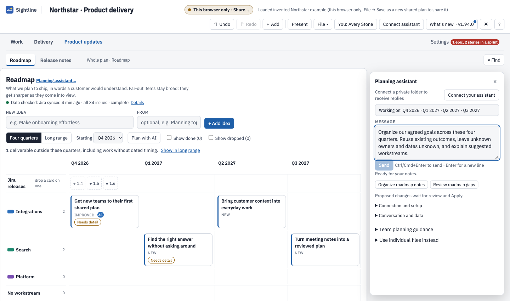
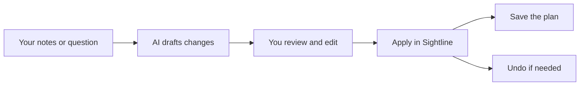
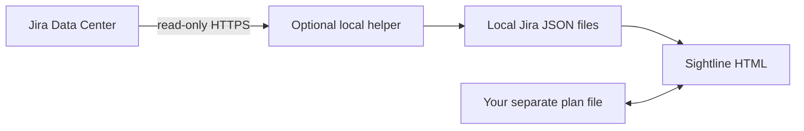

<div align="center">

# Sightline

### Your team's work, in plain sight.

**Turn “what are we actually shipping?” into a plan everyone can see.**

[](https://www.npmjs.com/package/@troylar/sightline)
[](LICENSE)
[](package.json)

[Get started](#your-first-plan-in-five-minutes) · [Take the tour](#one-plan-four-conversations) · [Plan with AI](#an-assistant-that-helps-you-change-the-plan) · [Use the skills](#six-skills-for-your-ai-assistant)

</div>

Sightline brings your roadmap, delivery timeline and Jira context into **one HTML file**. Open it in Chrome or
Edge. Put your plan in a separate file. Start with an idea; add detail as the team learns.

- **Give the next four quarters a shape.** Outcomes in the words a customer would understand, organized by workstream.
- **Connect the conversation to the work.** Move from the roadmap to the timeline, daily attention and release wording.
- **Let AI do the drafting.** Turn notes into proposed changes, review exactly what will change, and keep the final say.

<picture><source media="(prefers-color-scheme: dark)" srcset="docs/images/roadmap-dark.png"></picture>

*The invented Northstar team, planning Q4 2026 through Q3 2027. Targets can stay broad. Work outside the window stays available.*

## Your first plan in five minutes

**1. Get the app.** With Node.js 18 or newer:

```sh
npx @troylar/sightline install ./my-plan
```

Open **`my-plan/sightline.html`** in Chrome or Edge. That's the app. You can close the terminal.
The command also installs six planning skills in `my-plan/.sightline/skills` and a complete invented plan in
`my-plan/example`. To explore immediately, open **example/plan.json** from the app, then connect **example/jira**
in **Settings → Jira connection**.

**Prefer a download?** Get `sightline.html` from [the latest release](https://github.com/troylar/sightline-planner/releases/latest).
The HTML needs no Node.js, Python, server or account to open. npm is just a convenient way to get it.

**2. Add one outcome.** Choose **Product updates → Roadmap**. In **New idea**, type something a customer would
recognize, such as “New teams can create their first shared plan.” Choose **+ Add idea**. Open its card to add
timing and detail when you know them. You can start without Jira or an AI connection.

**3. Give the next year a shape.** Keep **Four quarters** selected and choose the starting quarter, including
the year. Add a few outcomes. **Long range** shows the broader horizon; **Show in long range** recovers work
outside the current window. A target quarter is planning intent, not a delivery guarantee.

**4. Keep it.** Choose **File → Save as a new shared plan…** and save a separate JSON plan file.
For a download instead, choose **File → Download JSON**. The toolbar tells you whether you're using a shared
file or **This browser only**. Browser-only work belongs to that browser; keep a download before relying on it.

**5. Bring someone in.** Share the HTML and plan through your team's usual file service. They open the HTML,
choose **File → Open shared plan…** and select the plan. Choose yourself in the toolbar for personal views
and author stamps. Follow the [team-folder guide](docs/onedrive.md) before relying on shared editing.

[Follow the illustrated walkthrough](docs/getting-started.md), or [download the synthetic Northstar plan](examples/northstar/plan.json) to explore a populated example.

## One plan, four conversations

### “What are we trying to ship?”

**Product updates → Roadmap** is the meeting view: outcomes, calendar quarters and workstreams. Far-out ideas
can stay broad. An outcome's customer wording can later become release notes. Roadmap uses the whole plan,
so a personal Timeline filter won't quietly hide part of the product conversation.

### “How does the work fit together?”

**Delivery → Timeline** puts initiatives, tasks, Jira work and milestones in time. Open an item to inspect
what came **From Jira** and what was **Added here**. Saved views help different people focus on the same plan.

<picture><source media="(prefers-color-scheme: dark)" srcset="docs/images/timeline-dark.png"></picture>

*Jira supplies issue facts and sprint dates. Sightline supplies the plan around them.*

### “What needs our attention today?”

**Work → Today** brings attention and next actions together. **Work → Sprint** follows current sprint work by
person, workstream or epic. Freshness and incomplete coverage stay visible; a quiet screen doesn't establish
that the team has enough capacity.

<picture><source media="(prefers-color-scheme: dark)" srcset="docs/images/today-dark.png"></picture>

### “What should we tell everyone else?”

**Delivery → Status update** helps with the wider delivery conversation. **Product updates → Release notes**
collects customer wording for Jira releases. Final release notes include Done outcomes whose wording is approved;
unfinished work remains distinguishable from what shipped.

[Find the right workspace](docs/workspaces.md) for your role and the question you're answering.

## An assistant that helps you change the plan

Paste the rough notes while everyone is still in the meeting:

> Organize these ideas across the next four quarters. Reuse existing outcomes. Keep unknown owners and dates
> unknown, explain your suggested workstreams, and propose only the changes we agreed.

On Roadmap, **Plan with AI** carries the displayed quarters into the conversation. On an outcome, **Ask assistant
about this** carries its stable ID. **Working on** shows the scope before you send. Follow-ups retain earlier
selections, so you can compare the outcome you're discussing with the one you just left.

<picture><source media="(prefers-color-scheme: dark)" srcset="docs/images/assistant-dark.png"></picture>

*A draft request in the actual app. Replies require the optional companion or your external assistant; this is not a live AI response.*



Choose the connection that fits your team:

| You want to… | Use this |
| --- | --- |
| Talk to your company's Chat Completions endpoint inside Sightline | [The local Python companion](docs/assistant-workflow.md#talk-to-your-company-endpoint) |
| Use an assistant that can read and write local files | [A private assistant folder](docs/assistant-workflow.md#use-an-external-assistant) and the planning skills below |
| Keep the interaction manual | Export context, then connect a proposal through [the individual-file workflow](docs/assistant-workflow.md#existing-changes-files) |

Sightline doesn't include a model or an API subscription. The HTML makes no AI API requests. The optional
companion contacts your configured endpoint; company policy and endpoint billing still apply. AI proposals
change the plan only after review and Apply. Jira facts remain read-only.

## Six skills for your AI assistant

Skills give a compatible assistant a repeatable way to help. They are plain, self-contained `SKILL.md` files.
Install the collection where your assistant looks for skills, or point it at the installed folder:

```sh
npx @troylar/sightline skills --to ./planning-skills
```

| Skill | Start with a request like… |
| --- | --- |
| [`sightline-plan-roadmap`](skills/sightline-plan-roadmap/SKILL.md) | “Turn these goals into a four-quarter roadmap.” |
| [`sightline-meeting-to-plan`](skills/sightline-meeting-to-plan/SKILL.md) | “Capture the decisions from these notes.” |
| [`sightline-edit-plan`](skills/sightline-edit-plan/SKILL.md) | “Move this outcome to Q2 2027.” |
| [`sightline-review-plan`](skills/sightline-review-plan/SKILL.md) | “What are the three biggest gaps?” |
| [`sightline-status`](skills/sightline-status/SKILL.md) | “Give me a short leadership update.” |
| [`sightline-planning-guide`](skills/sightline-planning-guide/SKILL.md) | “Explain what belongs in each workstream.” |

Tell the assistant which private context folder to use. Read-only skills report findings; editing skills write
proposals for review. The local companion uses its built-in protocol and **Planning guide**; it does not load
installed skill files automatically. [How the skills fit](docs/skills.md) explains both routes.

## Add Jira when you're ready

The optional, read-only Python helper supports **Jira Data Center**. It runs on a trusted computer, reads Jira
over HTTPS and writes local JSON files. Connect that folder in **Settings → Jira connection**. The page reads
those files and never contacts Jira. Jira Cloud support is not claimed.



Jira owns titles, status, assignees, points, hierarchy and sprint dates. Sightline owns placement, plan items,
annotations and proposals. “Not in the last sync” doesn't mean “deleted.” Your team's added work stays.

[Connect Jira step by step](docs/jira.md). Credentials stay in the operating system's credential store; helper
configuration belongs on the token holder's computer, outside the shared folder.

## A few things to know before you rely on it

<details>
<summary><b>Is it really one file? Does it work offline?</b></summary>

The app, JavaScript and YAML library are embedded in one HTML file. Plans stay separate. Core planning works
without a server or sign-in. The stylesheet requests Google Fonts when available and falls back to system fonts;
the app therefore isn't a zero-network app. Jira syncing and AI replies need their optional helpers and network
access. Linked file access works best in desktop Chrome or Edge.

</details>

<details>
<summary><b>How do saves and shared folders work?</b></summary>

Open the shared plan deliberately. Use **Start editing**, make your changes, then **Save** and **Done editing**.
Some quick updates save immediately; inspect the visible save state. Sightline checks local content and revisions,
keeps recovery copies and supports Undo. Edit locks are advisory. A local save doesn't prove that OneDrive uploaded
it or another device downloaded it. [Shared-file and recovery guide](docs/onedrive.md).

</details>

<details>
<summary><b>Is choosing my name a login?</b></summary>

No. Names and author stamps help people understand the plan; they don't verify identity. Shared files, folder
pickers, locks and review receipts are not access controls. Use file-service and OS permissions to control access.

</details>

<details>
<summary><b>How do I update without losing work?</b></summary>

Keep the current app open. Save the shared plan, or download JSON for browser-only work. Copy or submit unsent
drafts before closing the old tab. Install the new app into a new directory, open it, then open the existing plan
from its **File** menu. The installer refuses to replace different files, including customized skills. You may
need to reconnect file permissions. The plan and app remain separate files.

</details>

## Go deeper

| Guide | What you'll be able to do |
| --- | --- |
| [First five minutes](docs/getting-started.md) | Create, save and reopen a plan; explore Northstar |
| [Workspace guide](docs/workspaces.md) | Choose views and understand filters and hidden work |
| [AI planning](docs/assistant-workflow.md) | Set up the companion or external assistant; review proposals |
| [Planning skills](docs/skills.md) | Use the six reusable workflows |
| [Jira setup](docs/jira.md) | Connect read-only Jira Data Center sync |
| [Shared files and recovery](docs/onedrive.md) | Work as a team and recover conflicting copies |
| [Contributing](CONTRIBUTING.md) | Build, verify and contribute synthetic examples |
| [What's changed](CHANGELOG.md) | See the release history |

## Build from source

```sh
git clone https://github.com/troylar/sightline-planner.git sightline
cd sightline
npm ci
./build.sh
./test/run.sh
```

Requirements: Node.js 18+, Python 3, Bash and `timeout` on PATH. Open the generated **`dist/sightline.html`**,
not the source template. The source archive doesn't include generated `dist/` output.

Sightline is [MIT licensed](LICENSE). [Third-party notices](THIRD-PARTY-NOTICES.md).
