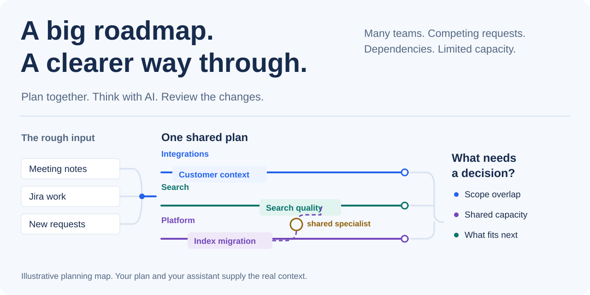
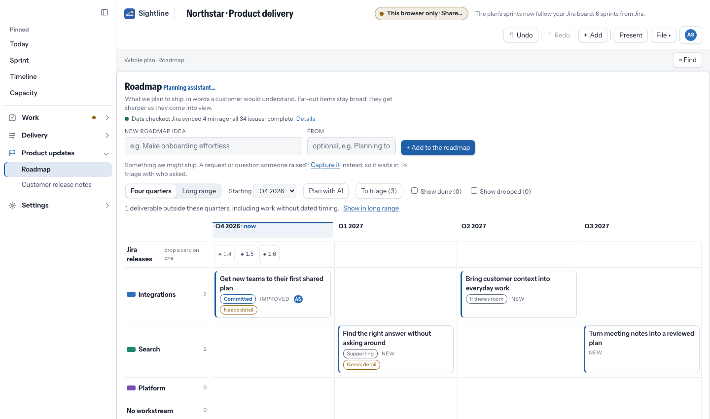
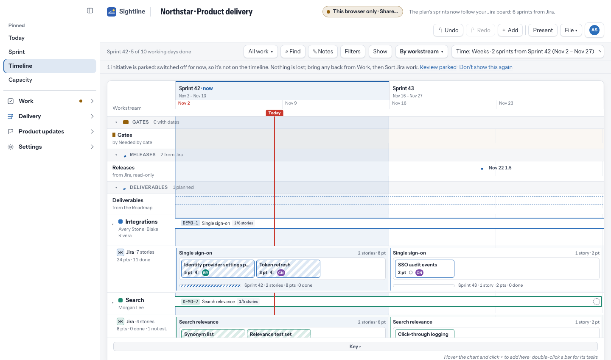
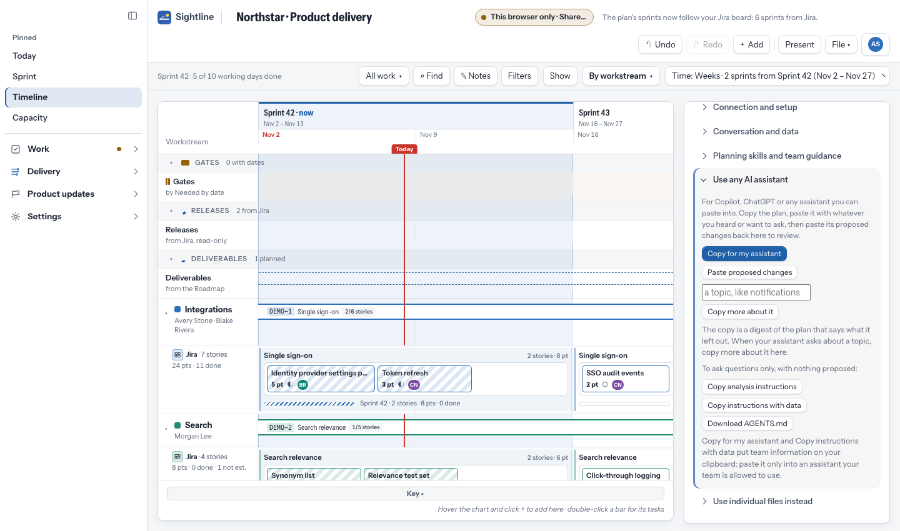
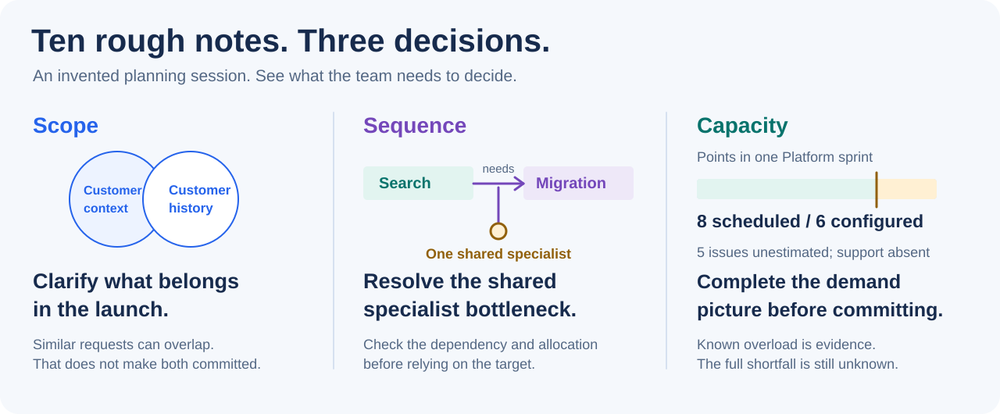
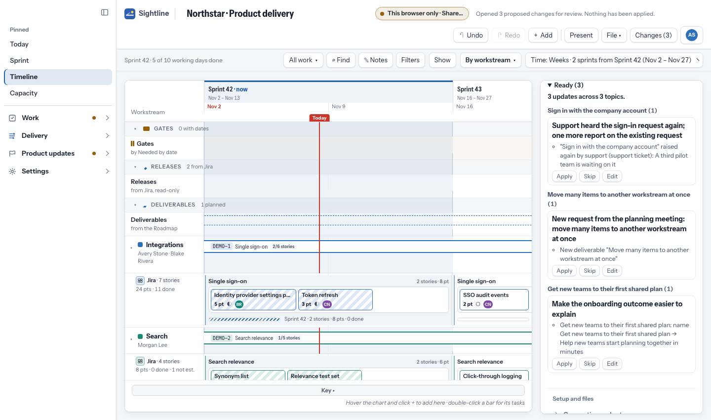
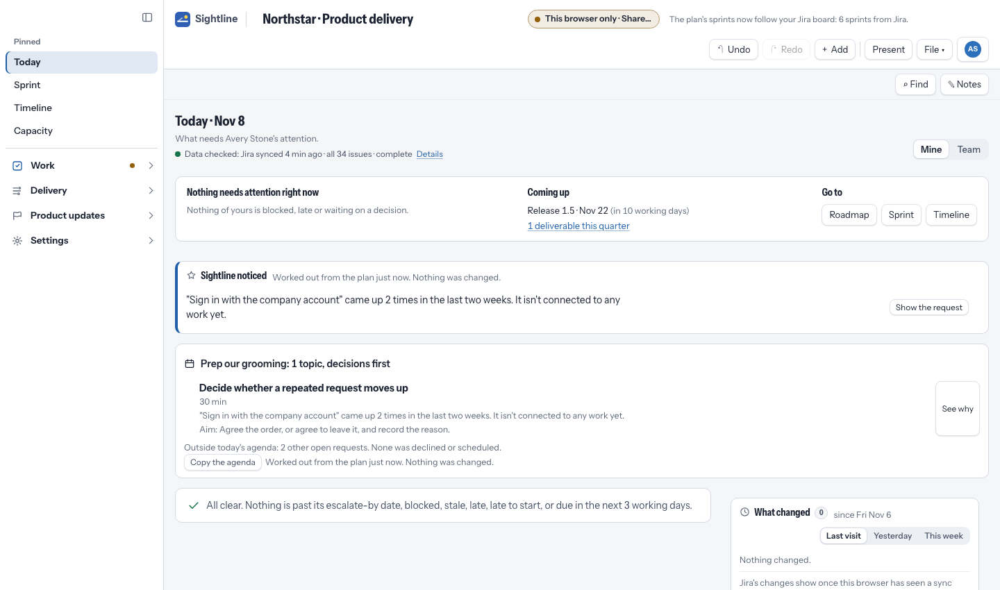

# Sightline

<picture>
  <source media="(max-width: 640px) and (prefers-color-scheme: dark)" srcset="docs/images/roadmap-map-mobile-dark.svg">
  <source media="(max-width: 640px)" srcset="docs/images/roadmap-map-mobile-light.svg">
  <source media="(prefers-color-scheme: dark)" srcset="docs/images/roadmap-map-dark.svg">
  
</picture>

**Sightline is a shared planning workspace for teams managing a large, changing roadmap—with their own AI assistant.**

You have requests in meeting notes, work in Jira, and several teams depending on one another. Everyone knows
part of the plan. Sightline connects the outcomes, delivery work, people, and decisions so you can work through
the whole picture together. Your assistant helps organize the complexity; you decide what changes.

<p align="center">
  <a href="docs/roadmap-planning-example.md"><b>See a planning session</b></a> &nbsp; / &nbsp;
  <a href="docs/getting-started.md"><b>Try the example</b></a> &nbsp; / &nbsp;
  <a href="docs/assistant-workflow.md"><b>Bring your AI</b></a>
</p>

## 1. Get the whole roadmap into view

What are we trying to deliver? What is agreed, and what is still an idea? Start with outcomes across quarters
and workstreams. Keep later work recoverable without turning every rough request into a dated commitment.

<a href="https://raw.githubusercontent.com/troylar/sightline-planner/main/docs/images/roadmap-light.png" aria-label="Open full-size roadmap screenshot"><picture><source media="(prefers-color-scheme: dark)" srcset="docs/images/roadmap-dark.png"></picture></a>

*Actual app, invented Northstar plan. A target quarter expresses intent; it does not prove capacity.*

## 2. Connect the roadmap to the work behind it

Move from the quarter-level discussion to initiatives, tasks, milestones, and dependencies. Keep work
**From Jira** alongside work **Added here**. Use saved views to focus on a team or workstream while keeping
hidden work findable.

<a href="https://raw.githubusercontent.com/troylar/sightline-planner/main/docs/images/timeline-light.png" aria-label="Open full-size timeline screenshot"><picture><source media="(prefers-color-scheme: dark)" srcset="docs/images/timeline-dark.png"></picture></a>

*Jira owns issue facts. Sightline owns the plan around them. Arranging work here does not update Jira.*

Roadmap uses the whole plan; Timeline and Capacity retain their own views and filters.
[Understand views and scope](docs/workspaces.md).

## 3. Use AI to work through the complexity

Bring the messy version: requests, constraints, meeting notes, emails, bug reports, a leader's priorities, or a
brain dump. Use the AI assistant you already work with: a coding assistant reading your private assistant folder,
or any chat assistant you paste into with **Copy for my assistant**. With the **sightline-plan** skill it sorts each
piece against existing work (a new request, one more report of an existing one, a decision, a risk, or a question),
answers what you asked, and helps you think through choices.

<a href="https://raw.githubusercontent.com/troylar/sightline-planner/main/docs/images/assistant-light.png" aria-label="Open full-size assistant setup screenshot"><picture><source media="(prefers-color-scheme: dark)" srcset="docs/images/assistant-dark.png"></picture></a>

*Your conversation stays in your own assistant. Sightline gives it the plan and the skill, and reviews what it
proposes. The in-page chat is optional.*

> Account for every request. Match it to existing work, flag a possible duplicate, retain it as an idea, or
> identify a decision. Suggest an arrangement around outcomes. Keep commitments separate from suggestions.
> Show what we need to know about capacity before deciding what fits. Do not change the plan yet.

<picture>
  <source media="(max-width: 640px) and (prefers-color-scheme: dark)" srcset="docs/images/planning-decisions-mobile-dark.svg">
  <source media="(max-width: 640px)" srcset="docs/images/planning-decisions-mobile-light.svg">
  <source media="(prefers-color-scheme: dark)" srcset="docs/images/planning-decisions-dark.svg">
  
</picture>

*An invented exercise, not a screenshot or captured AI response. [Follow all ten source notes through the planning session](docs/roadmap-planning-example.md).*

Compare scope, sequencing, and workload options in the conversation. To see what one option does to the forecast,
use **What if we take on something new, or move something up?** in Capacity's Forecast: it works on a copy of the plan, says what would finish later or earlier and
what has no estimate yet, and saves nothing. Then ask for proposals for the changes you choose.

**Say what matters, and why.** Give each outcome a priority (**Committed**, **Supporting**, or **If
there's room**: rocks, pebbles, and sand) with a reason. Set the team's **Work order** in Capacity's Forecast; the
forecast gives people to the work at the top first. Write down **What matters now** for the period, with dates and a
review date. Requests keep who asked, how it came in, and why it matters, and wait in **To triage** until someone
hands them off or declines them. Your assistant can suggest any of this; a person decides.

**Capacity needs evidence.** Known load, availability, missing estimates, and dependencies matter. An outcome
count alone cannot tell you what fits. Through the private folder, the assistant's context includes capacity,
dependencies, risks, and decisions; **Copy for my assistant** sends a shorter digest without them, so paste that
evidence yourself. Either way it covers known scheduled Jira points and configured availability, not every form of
demand.
[Capacity reasoning](docs/large-roadmaps.md#3-ask-what-actually-constrains-delivery) · [Build availability](docs/availability.md).

## 4. Review changes before they become the plan

See before/after values, grouped by the topic each change is about. Apply, edit, or skip each proposal. A change
to the work order, an outcome's priority or reason, or what matters now is a decision you accept on its own, never in
a batch. Use Undo for a
just-applied plan edit. Your assistant's conversation and proposal file do not silently change the shared plan.
With an assistant you can only paste into, choose **Paste proposed changes** and paste its reply; each change still
opens for your review.

<a href="https://raw.githubusercontent.com/troylar/sightline-planner/main/docs/images/review-light.png" aria-label="Open full-size review screenshot"><picture><source media="(prefers-color-scheme: dark)" srcset="docs/images/review-dark.png"></picture></a>

*Actual review of a prepared Northstar reply, pasted with **Paste proposed changes**. Nothing is applied until
someone chooses Apply.*

[Try a prepared review yourself](docs/getting-started.md#review-two-changes): move one outcome to an earlier
quarter and capture another as an unscheduled idea. No AI account needed.

## 5. Keep the plan useful between meetings

Find attention items in **Today**, current work in **Sprint**, and the delivery conversation in **Status update**.
Today opens with **Sightline noticed** (up to three things worth a look) and offers **Prep our grooming**, a short
agenda for the next grooming session that starts with decisions. Neither changes the plan. Use **Customer release
notes** for customer wording. Return to Roadmap for the broader direction.

<a href="https://raw.githubusercontent.com/troylar/sightline-planner/main/docs/images/today-light.png" aria-label="Open full-size today screenshot"><picture><source media="(prefers-color-scheme: dark)" srcset="docs/images/today-dark.png"></picture></a>

*The same invented plan, viewed for daily attention. Check scope and freshness before relying on the summary.*

Have your assistant prepare a review, turn meeting notes into proposed updates, or draft an explanation of what
changed from supplied evidence. [Run a team planning session](docs/team-planning.md) · [Explore the planning skill](docs/skills.md).

## How it works

**One HTML app. A separate plan file. Your own AI tool.**

- Open Sightline in desktop Chrome or Edge. Your plan is JSON or YAML; share it through your team's file service.
- Use your own AI assistant. Connect a private assistant folder: Sightline writes context, your file-capable assistant writes proposals, and you review them here. For an assistant that can't read files, use **Copy for my assistant** and **Paste proposed changes**. Your tool supplies the model connection; an in-page chat is optional.
- Optionally add the read-only Jira Data Center helper. The page reads its local outputs and never contacts Jira.

There is no planning server or account to set up. Shared files need coordinated editing and handoffs: locks are
advisory, author names are not verified identities, and a local save does not prove cloud delivery. Use file-service
permissions for access. The page makes no network requests: its font is embedded too. Connect the plan's folder
(**Delivery → Activity**, **Connect the plan's folder…**) and, when you save while editing, snapshots, status updates
and item updates older than 30 days move into history files beside the plan, one per quarter, so the plan file stays
small. Each item's latest update and the newest snapshot and status update stay in the plan file.

[Assistant setup](docs/assistant-workflow.md) · [Jira setup](docs/jira.md) · [Sharing and recovery](docs/onedrive.md).

## Install

Sightline is one HTML file you open in Chrome or Edge, plus an optional planning skill for your AI assistant and an
optional read-only Jira helper. It never writes to Jira. With Node.js 18 or later:

```sh
npx @troylar/sightline install my-sightline
```

That creates **my-sightline/** with **sightline.html**, the **sightline-plan** skill in **.sightline/skills/**, and an
invented example plan in **example/**. Open **my-sightline/sightline.html** and choose **File → Open shared plan…** to open
**example/plan.json**, or start your own plan. It never replaces a file that's already there; to update, install into
a new folder and open your plan from the new app. Since 1.184.0 one skill replaces the seven that earlier versions
installed; remove the older `sightline-` skill folders your assistant reads. `npx @troylar/sightline helpers` prints the folder that holds the
Python helpers (the Jira sync and the assistant tools), which need Python 3.10 or later.

## Try it with an invented team plan

To build from source instead, you need Git, Node.js 18+, Python 3.10+, and Bash:

```sh
git clone https://github.com/troylar/sightline-planner.git sightline
cd sightline
npm ci
./build.sh
```

Open **dist/sightline.html** in Chrome or Edge. Choose **File → Open shared plan…** and select
**examples/northstar/plan.json**. [Follow the first-session walkthrough](docs/getting-started.md).

Or give your coding assistant the repository link and ask:

> Clone Sightline into a new folder, read its project instructions, install its development dependencies,
> and build the HTML. Tell me where to open it and the Northstar example. Preserve any existing checkout.

[Check which version each install route gives you](docs/availability.md).

## Documentation

| Plan | Connect | Operate |
| --- | --- | --- |
| [Worked planning session](docs/roadmap-planning-example.md) | [Your AI assistant](docs/assistant-workflow.md) | [Team planning](docs/team-planning.md) |
| [Large roadmaps and capacity](docs/large-roadmaps.md) | [Jira Data Center](docs/jira.md) | [Views and scope](docs/workspaces.md) |
| [First session](docs/getting-started.md) | [Planning skill](docs/skills.md) | [Shared-file recovery](docs/onedrive.md) |

[Contributing](CONTRIBUTING.md) · [Release history](CHANGELOG.md) · [MIT license](LICENSE) · [Third-party notices](THIRD-PARTY-NOTICES.md).
