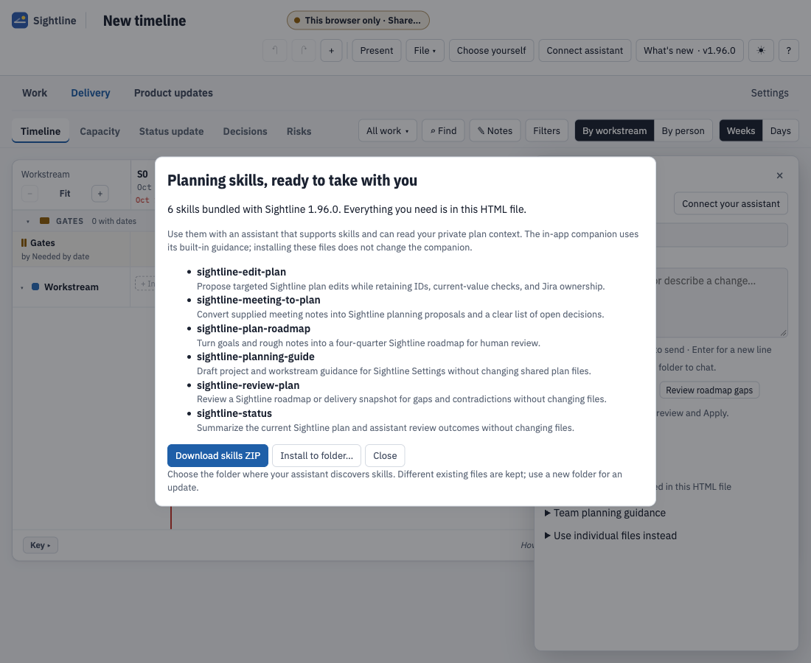

# Take the planning skills straight from the app

**Requires Sightline 1.95.0 or later.** Public-source 1.94.0 uses the checkout's **skills/** folders instead.
Check [build availability](availability.md) and your app's version before looking for this dialog.

Your **sightline.html** includes the planning skills that were present when it was built. You can deploy them
without the repository, Node.js, npm or Python. Keep this HTML file; the skills travel with it.

## Open the collection

Choose **Connect assistant** in the menu under your name (or, once an assistant is connected, the assistant button in the toolbar), then **Setup and files → Planning skills and team guidance → Planning skills**. You can also open
**Settings → Planning guide → Get planning skills**. The dialog shows the bundled Sightline version and each
skill's purpose. You don't need to connect a plan or an AI endpoint to get the files.

<picture><source media="(prefers-color-scheme: dark)" srcset="images/bundled-skills-dark.png"></picture>

## Download a ZIP

Choose **Download skills ZIP**. Unzip it, then put the `sightline-*` folders where your assistant discovers skills,
or point the assistant at that folder. Each folder contains its `SKILL.md`; the archive also contains the license.
The ZIP is generated from data already inside the HTML. No network request is needed.

## Install directly into a folder

In Chrome or Edge, choose **Install to folder…**, then select your assistant's skills directory. Sightline checks
all destinations first and copies only the bundled skills and a license under `_sightline/LICENSE`.

- Identical files are left alone.
- Different existing skill files cause the installation to stop before writing. Choose a new folder to compare
  an update with your team's customized copy.
- An interrupted installation reports confirmed completed files. Those files are kept; choose a new folder to
  retry if an incomplete file blocks installation.

Use one installer at a time. File-provider operations are not a transaction, and local writes do not confirm
cloud delivery. The installer doesn't touch your plan, assistant context, proposals, results or unrelated files.
It doesn't replace your current assistant-folder connection.

## What “bundled” means

The dialog identifies the app version the skills came with. An HTML file is a snapshot: it cannot pick up skill
changes made after that build. To get newer skills, get the newer **sightline.html**, open this dialog again and
compare or install its collection. There is no background download or automatic overwrite.

A running assistant still needs access to the plan's [private context folder](assistant-workflow.md). Installing
skills doesn't connect a model or change the in-app companion's protocol. See [the six planning workflows](skills.md)
for ordinary-language requests you can start with.
