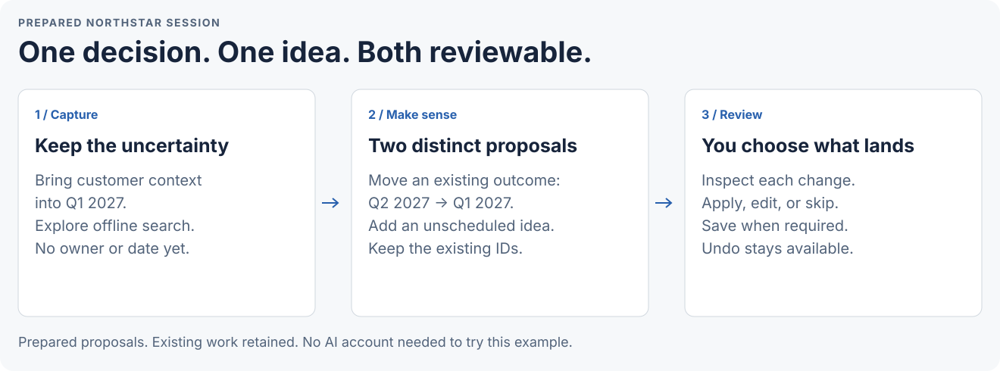

# Your first useful planning session

Open an invented team plan, review two changes, and save something you can reopen. No Jira server or AI
account is needed for this example. [Back to the tour](../README.md).

## Open the example

Build the public source with Git, Node.js 18+, Python 3.10+, and Bash:

```sh
git clone https://github.com/troylar/sightline-planner.git sightline
cd sightline
npm ci
./build.sh
```

Open **dist/sightline.html** in desktop Chrome or Edge. Choose **File → Open shared plan…** and select
**examples/northstar/plan.json**. This is synthetic work, safe to explore. Choose Avery Stone for the example author stamps if asked; this is not a login. Your HTML is the app; the JSON is the plan.
Public npm and release downloads are not available yet; [check availability](availability.md) before using other instructions.

Choose **Product updates → Roadmap**. Select **Four quarters**, starting **Q4 2026**. Find:

- **Bring customer context into everyday work**, currently targeted for Q2 2027.
- **Explore a workspace for partners**, an idea for Later. Keep it there throughout this exercise.

Jira is optional. To populate the delivery views, connect **examples/northstar/jira** through
**Settings → Jira connection**. This is a dated documentation snapshot; freshness warnings can be expected as it ages.

## Start with the rough notes

Read [brain-dump.txt](../examples/northstar/brain-dump.txt):

> Bring customer context forward to Q1 2027. Explore offline search too, but keep it as an idea with no
> owner or date. Leave the rest of the roadmap as it is.

A useful assistant separates the agreed timing change from the requested idea capture. It keeps the existing
outcome's ID, leaves the new idea unassigned, and does not turn this into a wholesale reschedule.

<picture>
  <source media="(max-width: 640px) and (prefers-color-scheme: dark)" srcset="images/planning-story-mobile-dark.svg">
  <source media="(max-width: 640px)" srcset="images/planning-story-mobile-light.svg">
  <source media="(prefers-color-scheme: dark)" srcset="images/planning-story-dark.svg">
  
</picture>

## Review two changes

The repository contains [roadmap-session-amendments.json](../examples/northstar/roadmap-session-amendments.json),
a **prepared example**, not a live model response. With the Northstar plan open:

1. Choose **Connect assistant** in the toolbar and expand **Use individual files instead**.
2. Choose **Connect that file**, then select **examples/northstar/roadmap-session-amendments.json**.
3. Inspect the two proposals: move **Bring customer context into everyday work** from **Q2 2027** to **Q1 2027**;
   add **Explore offline search** as an unscheduled idea with no owner.
4. Apply either proposal independently. You can edit or skip one without accepting the other.
5. Check the visible save state and use normal **Save** if required. **Undo** reverses a just-applied plan edit.

If both changes are ready and you apply them, the result is:

| Item | Before | After |
| --- | --- | --- |
| Customer context, `dv-integrations` | Idea, Q2 2027 | Planned, Q1 2027; same ID and workstream |
| Offline search, `dv-offline-search-idea` | Not in the plan | Idea; no owner or target date |
| Partner workspace, `dv-later` | Later | Still Later |
| Other outcomes | Existing values | Unchanged |

Giving the timed customer-context idea its new target marks it **Planned**. That is a planning state, not a capacity or delivery guarantee.

The new idea may sit outside the four-quarter window. Follow the outside-window control or choose **Long range**
to find it. Hidden does not mean lost. If a current value differs from the proposal's precondition, review the
conflict instead of forcing it. Only a ready change can be applied.

The earlier **sightline-amendments.json** remains available as a separate two-change wording example.
Do not connect both batches at once.

## Make a plan of your own

Preserve any example edits you want first. Choose **File → Open a copy…** and select
**examples/northstar/blank-plan.json**. This opens an empty, detached plan rather than linking writes to the
example file. In Settings, set your plan title and calendar before scheduling work. On Roadmap, add an outcome
in **New idea**, such as “New teams can create their first shared plan.” Keep unknown timing and owners unknown.

Choose **File → Save as a new shared plan…** and save a separate JSON file. Confirm that the toolbar identifies
it as a shared plan. Close and reopen the app, choose **File → Open shared plan…**, and select that file.
For browser-only work, keep a **Download JSON** backup before closing. Composer drafts need to be submitted or
copied separately.

## Bring your own assistant

1. Open your own plan and connect a private folder using **Connect assistant → Connect your assistant**.
2. Choose **Copy instructions for your assistant**. Paste them into your external coding tool with that folder's location.
3. Point it at the source checkout's **skills/** folder, or install the individual skill folders where it discovers them.
4. Start with a small real request. The assistant reads fresh context and writes proposals; you review and apply them here.

> Read my current context. Group these notes against existing outcomes, keep suggestions separate from decisions,
> and show the three questions that matter most. Do not invent owners or dates. Prepare only the changes I request.

You do not need to use the in-app **Send** button for an external tool. Continue in that tool's conversation.
[Complete external setup](assistant-workflow.md) · [Work through a large roadmap](large-roadmaps.md) · [Run a planning meeting](team-planning.md).
